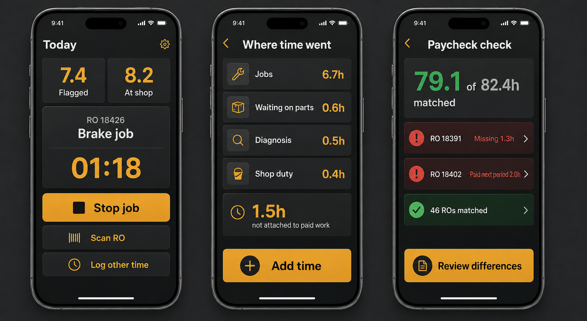
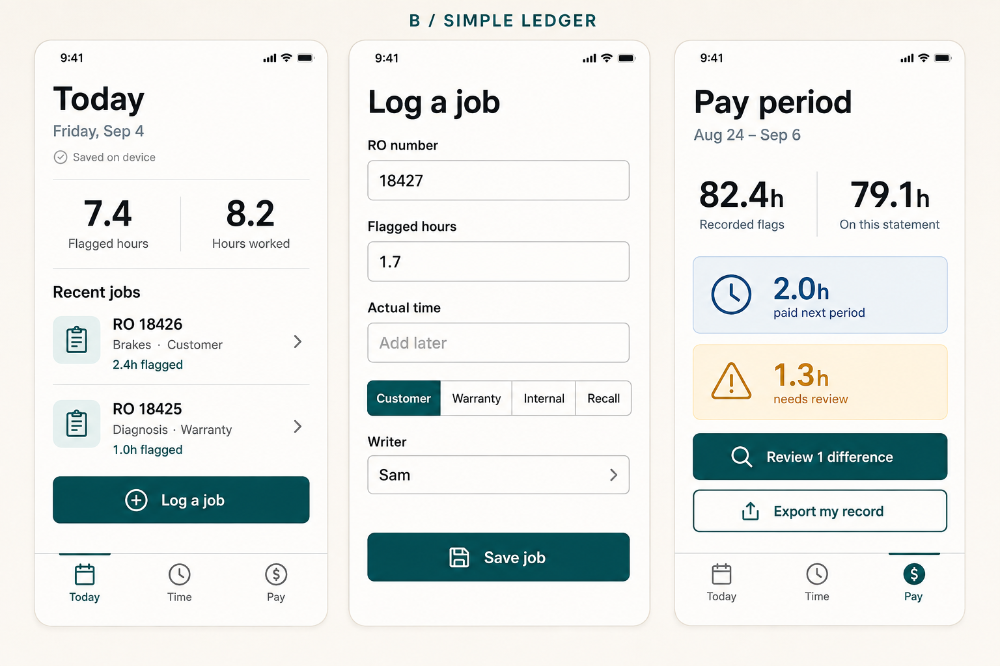
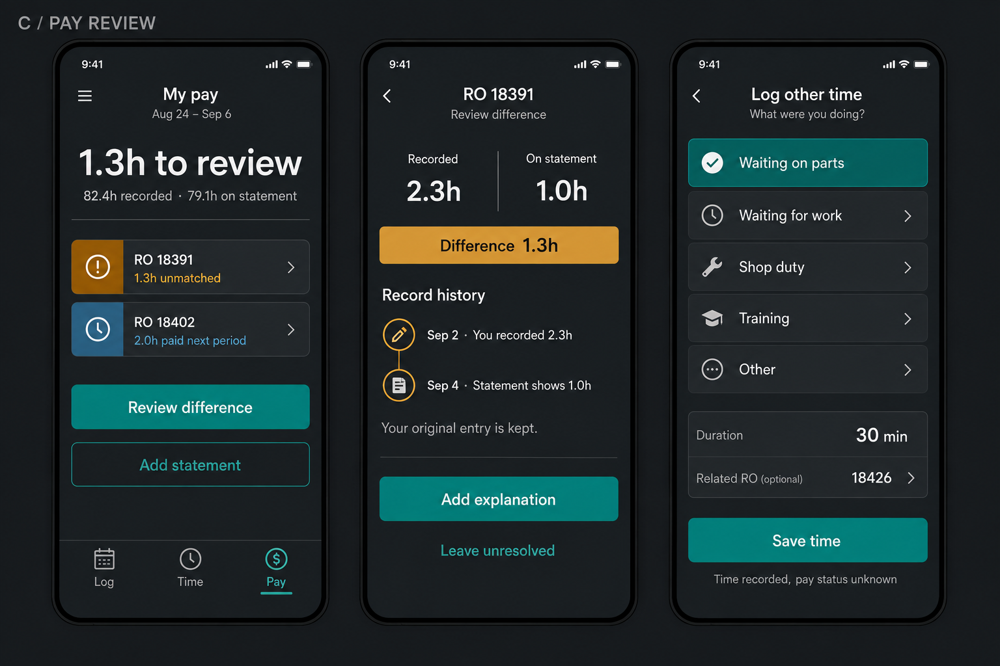

# Flat Rate: product concepts

Created 5 September 2026 using the built-in image-generation tool and the imagegen skill. These are raster concept images, not implemented screens or interactive prototypes. All numbers and repair orders are invented examples.

Read alongside the [scope proposal](../plans/scope-change-proposal-2026-09-05.md), [competitor landscape](../../readings/competitive-landscape-2026-09-05.md), and [dealership research](../../readings/dealership-systems-2026-09-05.md). The three concepts illustrate the personal technician product; an owner-facing interface has not been designed or approved.

## A: bay workflow

The original concept emphasizes the current job and time capture. Its timer and scan button are exploratory, later-scope possibilities. It is more visually dense than B and C.

Known refinements: show confirmed later payment in a neutral status, not red; replace “missing” with “unmatched” until reviewed; do not infer that time outside recorded operations was unpaid. Diagnosis can be part of job time. “At shop” needs a precise worked-time/break definition before implementation.

## B: simple ledger

A calmer, light layout, with optional actual time and a clear manual-entry path. Recommended starting point for a first usability test because it closely matches what the existing app can evolve into. Contrast and sunlight readability need device testing.

## C: pay review

Makes the proposed benefit visible: identify a difference, inspect recorded history, and leave an item unresolved when evidence is insufficient. Teal secondary text needs an accessibility contrast check during implementation.

## Shared interpretation

82.4 hours recorded minus 79.1 on the selected statement leaves 3.3 hours. Of that difference, the example assumes 2.0 was confirmed on a later statement, leaving 1.3 to review. This is a retrospective review, not a prediction that a future payment is guaranteed. A real design must name/link the later statement.

Screen A's sample day has 6.7 job hours plus 0.6 waiting, 0.5 unassigned diagnosis, and 0.4 shop duty, totaling 8.2 worked hours. This partition is illustrative; it does not prescribe mutually exclusive categories for all real work.

Saved images were visually inspected for layout, text, and arithmetic. They do not establish tap counts, one-handed usability, accessibility, offline operation, or demand. [Full generation prompts](prompts.md) are retained for iteration.

## Summary

Three saved visual alternatives: A emphasizes bay activity, B fast entry, and C reconciliation history. The imagegen workflow produced and preserved the bitmap concepts. Next: show B and C to technicians and observe whether the proposed distinctions make sense before implementing screens.
